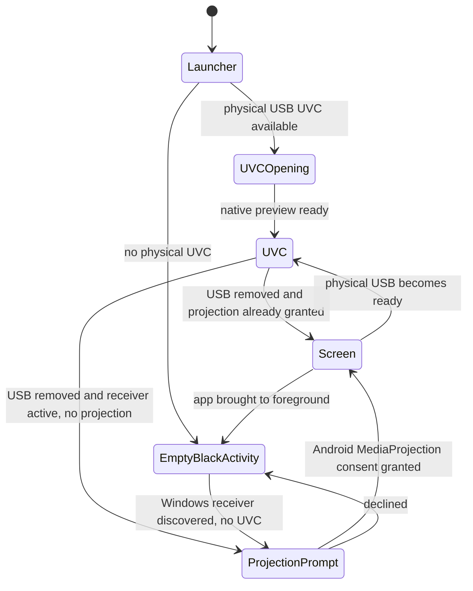
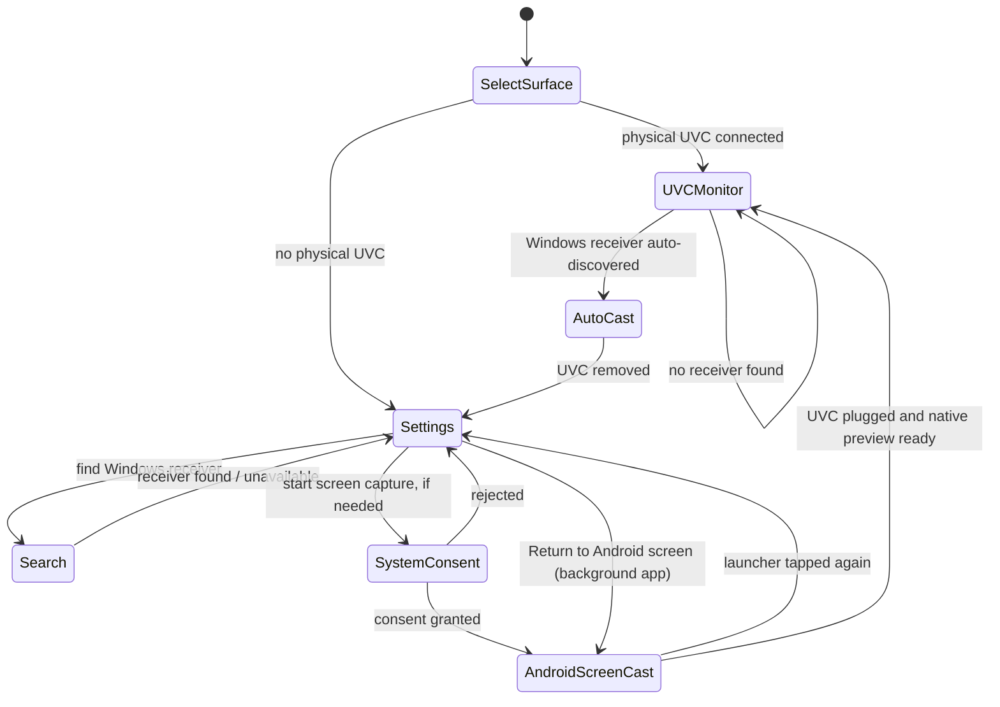

# v031 MyMonitor UX state and keyboard roadmap

Reviewed against `main` at `f58b062c` (v030). Android settings-screen prototype is on `v031-ui-keyboard`; no public v031 release until full regressions and phone-side verification.

## Current behavior (v030)

Problems:
- `MainActivity` always creates a black FrameLayout but only mounts the camera fragment when USB exists. No dedicated screen for a no-USB launcher/re-entry.
- USB auto-open and single verified Windows receiver are **already implemented** and should not be rewritten.
- Android accessibility permission is an OS grant; the app then requires `StreamHub.controlArmed` per session. Windows additionally requires Alt+R and currently defaults remote control OFF.
- MediaProjection must explicitly be approved by the OS; an automated screen recording consent bypass is not possible.
- Android foreground screen shows MyMonitor itself, rather than the intended Android content, if left in front during a screen capture session. Returning to the home screen after granting capture is deliberate.

## Target UX

### Button semantics on settings surface (no UVC, or launcher re-entry during UVC)

| Control | Behavior |
| --- | --- |
| Find Windows receiver | Verified discovery with selection when multiple peers exist |
| Allow Android screen capture | Opens Android standard MediaProjection request (or discovers a receiver first) |
| Remote operation | Requires accessibility service enabled and active Android-screen session; explicit per-session arm |
| Manual Windows peer settings | Existing verified IPv4 + port dialog |
| Return to Android screen | Background the settings Activity; keep casting active |

### Remote control proposal

- Do not bypass Android AccessibilityService's system grant or screen-capture consent.
- Maintain **Android per-session opt-in**, source=SCREEN, live transport, projection active, unlocked screen.
- Simplification proposed: once Android has explicitly armed the session, Windows should need no additional Alt+R enable action. Alt+R remains a local *pause/resume override* (default ready); see security considerations. **Not implemented in this v031 candidate**: the additional Windows Alt+R safeguard remains until authentication and permission UX are validated.
- Current transport has no cryptographic peer authentication. Do not expose TCP 57007, 57009 or UDP 57008 outside trusted LAN; add approved pairing before broader public distribution.

### v031 keyboard implementation boundaries

- Candidate implements op=8 for 1..15 bytes of committed UTF-8 and op=9 for common editing keys in the original 17-byte MMC6 reverse ACK. Older Android clients ignore unknown operations; UVC remains excluded.
- Windows receives committed Unicode from `WM_CHAR` and handles surrogate pairs. Android inserts via editable focused accessibility nodes using `ACTION_SET_TEXT` and `ACTION_SET_SELECTION`.
- This is *not* general HID key injection. Terminal keystrokes, clipboard shortcuts, password fields and complex IME behavior require separate device testing.
- Do not touch the v029 completed-gesture queue or existing UVC/recording/audio source lifecycles as part of keyboard work.
- Keyboard actions must be opt-in through the same session gate and discarded on disconnect/lock/source switch.

## Verification matrix

1. USB attached while app stopped: Android can open the app under existing OS rules; usable UVC preview; single verified receiver auto-connects.
2. No USB, receiver started: no empty black activity; settings display connection status and buttons; MediaProjection system permission appears only where necessary.
3. No USB, no receiver: settings remain usable; manual IP and discovery accessible.
4. Screen casting then re-open app icon: same Activity is reused when possible; settings overlay appears and has functioning controls. Return to Android screen without stopping stream.
5. UVC unplug/replug or screen rotation: existing preview priority and source switching unchanged; no stale fragment or doubled listener.
7. Explicit Android remote authorization remains OFF by default after reconnect, source change, or projection loss.
8. Existing Windows F11, Alt+R, wheel/pinch, low-latency audio and video and recording regressions pass.
9. Confirm Android device behavior by hand; JVM and Windows CI do not validate physical USB or Android MediaProjection system UI.

## Release discipline

Use dedicated PR and CI for this UX increment. Keep v030 tag and distribution untouched. Do not publish v031 until keyboard work, Android/Windows verification and release workflow are ready.
